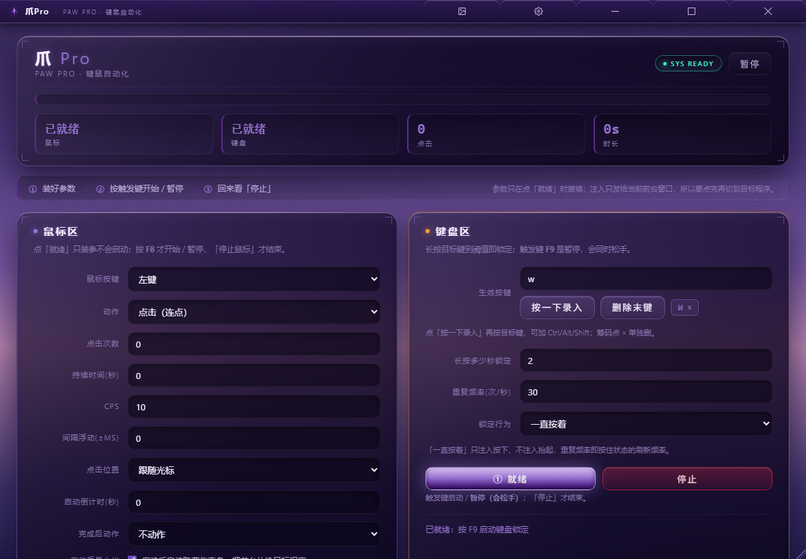
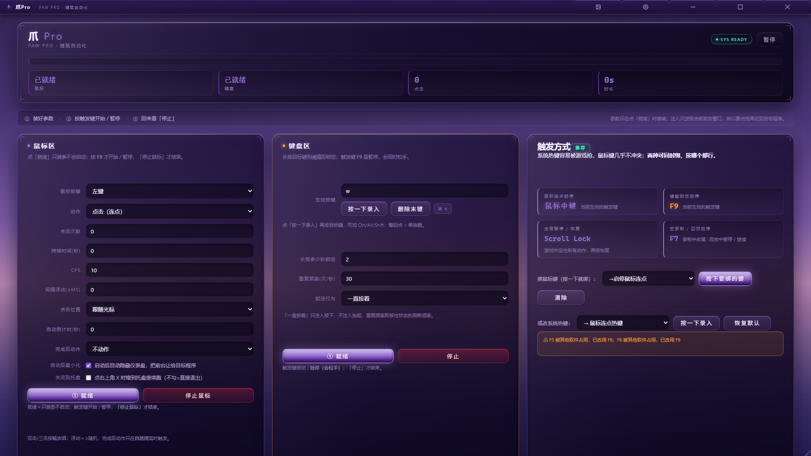
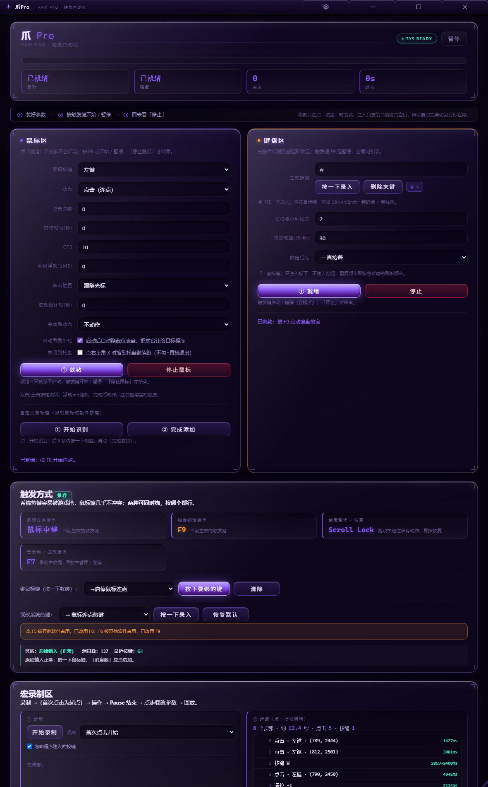
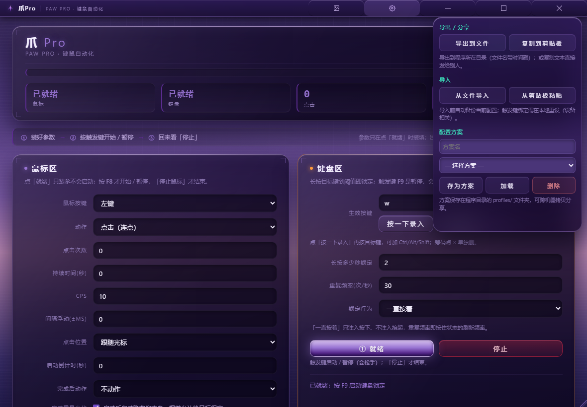
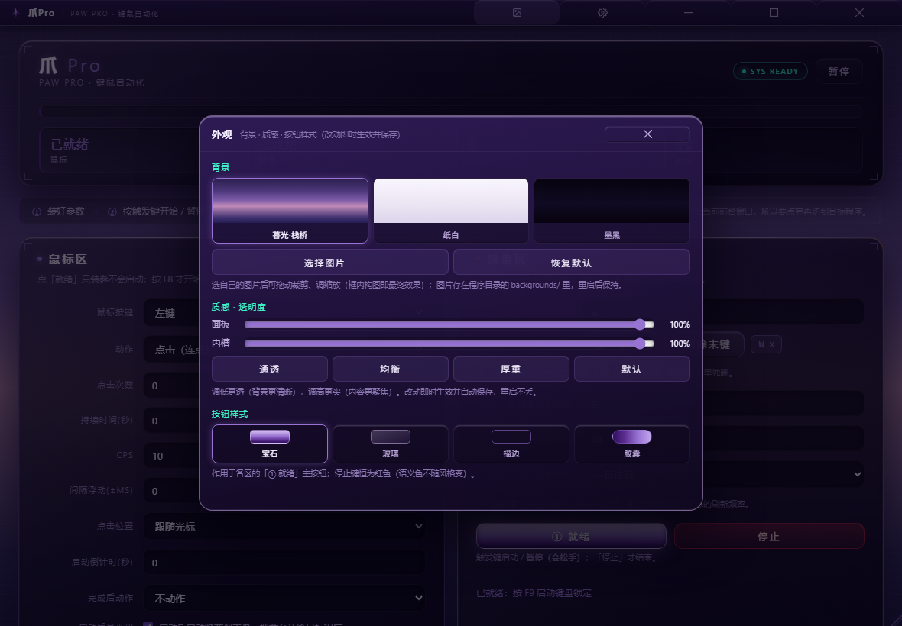

# 爪Pro（Paw Pro）

**Windows 桌面自动化工具**：鼠标连点 / 键盘长按锁定 / 宏录制回放。
Python + 纯 `ctypes` 调 Win32，PyInstaller 打成单文件 exe，双击即用，目标机器不需要装 Python。



---

## 一、它解决什么

手工重复的事情有两类：**同一位置点很多次**，和**按下某个键一直不放**。
市面上的连点器大多只做第一类，且没有暂停/恢复这类基本控制。

爪Pro 把这两件事做成同一套界面：鼠标区管连点，键盘区管长按，中间一条触发链管「开始 → 暂停 → 继续 → 停止」。
所有参数在界面上改，改完即时生效，关掉再开还在。

---

## 二、四个入口，四种用法

| exe | 定位 | 适合谁 |
|---|---|---|
| `爪Pro.exe` | 图形主界面，功能最全 | 日常使用 |
| `鼠标连点器.exe` | 命令行版 | 脚本调用、批量任务 |
| `长按锁定器-图形版.exe` | 轻量图形版，只管长按锁定 | 只需要一个键一直按住 |
| `鼠标连点器-长按锁定.exe` | 命令行长按锁定 | 自动化流程里嵌一步 |

图形版支持宽屏自适应：



---

## 三、功能

**鼠标区**
- 连点速度 / 单击·双击·三击 / 固定坐标或跟随当前位置
- 间隔浮动（±ms），避免节奏过于机械
- 多点轮询、框内随机取点
- 启动倒计时、点击次数上限

**键盘区**
- 长按锁定任意键，再按一次释放
- 与全局暂停联动：暂停 = 松手 + 解除锁定

**宏**
- 低层钩子录制真实的鼠标键盘序列，回放可调速
- 录到的步骤可逐节点编辑（增删、改间隔、改坐标）
- 宏独立存放在 `macros/`，不跟配置混在一起



**配置**
- 导入 / 导出 `.json`，支持剪贴板双向
- 多方案命名保存，一键切换
- 导入前自动备份，带 schema 版本校验（高版本拒绝导入）+ 字段白名单迁移



**界面**
- 无边框自绘窗口，可拖动、可缩放
- 三套内置背景 + 自定义背景（含裁剪器）
- 浅色 / 深色主题，面板透明度可调



---

## 四、技术实现

### 4.1 不依赖第三方 UI 框架

整个图形界面是 **Python + pywebview（WebView2）+ 原生 HTML/CSS/JS**，没有 Electron、没有 Qt。
好处是打包体积和启动速度可控；代价是窗口行为要自己实现。

### 4.2 自研无边框窗口拖动

标准做法是让 `WM_NCHITTEST` 对标题栏区域返回 `HTCAPTION`，交给系统处理拖动。
但这套界面要整块自绘圆角和阴影，`WM_NCHITTEST` 必须对所有位置返回 `HTCLIENT` —— 系统拖动就此失效。

解法是不走系统拖动，改为在 `WM_NCLBUTTONDOWN` 之外自己接管：捕获鼠标按下 → 跟踪移动 → `SetWindowPos` 重设位置，
并在缩放时按边角命中区计算新矩形。这条路径系统不提供辅助，边界条件（多屏、DPI 缩放、最大化状态）全部要自己兜。

### 4.3 提权窗口的输入注入

用 `SendInput` 向**以管理员权限运行的目标窗口**发输入时，会被 UIPI（用户界面特权隔离）**静默拦截**：
不报错，也不生效，表现为「点了没反应」。程序因此内置提权状态检测（`core/dpi.py` 同层），
启动日志里直接打印本进程是否已提权，第一次排查就不用靠猜。

### 4.4 DPI 感知贯穿四个入口

Windows 上非 DPI 感知进程会被系统做位图拉伸，坐标全部偏移。
`core/dpi.py` 在四个入口的 `main()` 最早期调用 `SetProcessDpiAwarenessContext`，
保证界面、截图、坐标换算三者一致。

### 4.5 插件架构

`core/` 是引擎，`plugins/` 是行为，五个插件各自独立、可增删：

```
plugins/normal_click.py   基础连点
plugins/drag_loop.py      拖拽循环（多点路径 + 步数与延时）
plugins/macro.py          宏执行
plugins/macro_replay.py   录制的宏回放（走统一 ctx.wait 时钟，不自己 sleep）
plugins/jiggler.py        鼠标抖器（防休眠）
```

新增一种行为只要实现插件接口并注册，引擎主循环不用动。

### 4.6 系统托盘用纯 ctypes 实现

没有引 `pystray` 之类的库，直接调 `Shell_NotifyIconW` + `CreatePopupMenu` + `TrackPopupMenu`，
双击显示窗口、右键菜单（显示 / 暂停 / 退出）。少一个依赖，打包就少一类坑。

### 4.7 配置 schema 迁移

用户升级版本后，旧配置文件必须还能读。导入时先比对 `schema_version`：
高版本拒绝（避免降级读坏数据），低版本按**字段白名单**迁移，导入前自动写 `.bak`。

---

## 五、工程实践

这是一个**迭代了 41 个版本**的项目（v9 → v41），每个版本都保留可运行的 exe 在磁盘上，从不清除。
过程中沉淀出的做法：

**回归测试 22 套。** 覆盖窗口状态机、鼠标区、按键绑定、触发链、配置读写、托盘、通知投递、录制回放等。
单套最多的一个（两段式状态机）有 339 条断言。测试**必须串行跑** —— 并行会争抢全局热键和剪贴板，导致假失败。

**打包后必须真跑一次 exe 并读启动日志。**
打桩测试全绿也覆盖不到 `main()` 的启动路径：历史上出现过一次 141 项全绿、exe 双击即崩。
现在构建带三道自动闸门 —— ① 产物时间戳属于本轮 ② 反编译 exe 内的 HTML 与源码 md5 一致 ③ 启动日志出现 DPI 感知行且进程存活。

**无边框窗口的坑记在文档里，不靠记忆。** 三条验收铁律：
① 必须右键以管理员身份运行，否则 UIPI 拦截会让注入无声失败；
② 验收前必须关掉旧实例 —— 单例互斥量会让新 exe 只把旧窗口顶到前面；
③ 打包后必须真跑 exe 并读启动日志（打桩测试覆盖不到启动路径）。

---

## 六、构建

```bash
pip install -r requirements.txt
# 双击 build.bat，或：
python build_cli.py
```

产物在 `dist/`。四个入口分别对应四个 spec。

> ⚠ 构建脚本必须在真实终端里跑。在 IDE 或 AI 会话里用脚本化方式喂 `build.bat`，
> 可能因 stdin 重定向 + 编码问题产出零文件。

---

## 七、已知边界

- **仅 Windows**：全部输入注入、热键、托盘都是 Win32 API，没有跨平台计划。
- **可能被安全软件拦**：模拟输入和全局热键属于安全软件重点关注的行为，首次运行可能需要加白名单。
- **不要用在违反目标软件服务条款的场景**：这是通用的输入自动化工具，使用者自行判断适用范围。

---

## 八、目录结构

```
core/           引擎（输入、热键、DPI、配置、托盘、通知、录制、状态机）
plugins/        行为插件（连点 / 拖拽循环 / 宏 / 回放 / 抖器）
ui/             界面层（HTML/CSS/JS）
assets/         图标与资源
docs/           开发文档与截图
交付/           交付包与效果图
build.bat       构建入口
```

---

## 许可证

个人项目，仅供学习与自用参考。
